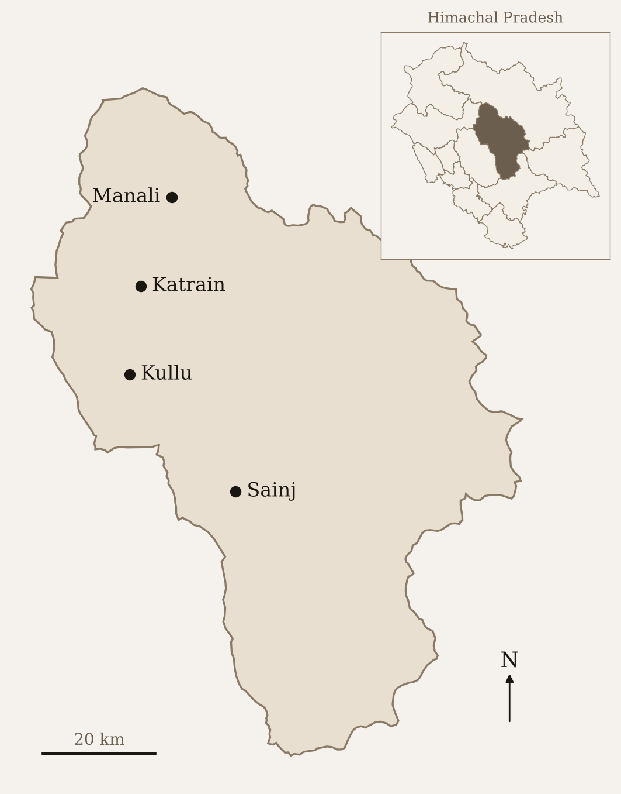



In [the first post of this series](/projects/kullu-land-use-and-tree-cover/), I used a satellite-based dataset to understand land use in Kullu district. It found about 880 hectares of cropland, against the roughly 39,000 hectares I quoted from government records. I called the satellite number wrong and promised a proper look later. Here it is. I go through the official records, the national land-use maps from the National Remote Sensing Centre (NRSC) and four global satellite datasets, to work out how cropland in the district is changing.

> **Short version.** Government records put Kullu's net sown area, which includes orchards, at about 37,000 hectares, and it has hardly changed since 1998. But the cropped area, which counts each sowing separately and adds them up, fell from about 65,000 hectares in 2003-04 to about 50,000 in 2022-23, so the same land is now sown about 1.4 times a year instead of 1.8. Fruit area, meanwhile, has grown by about 61% since 1990-91. NRSC's maps look the most plausible: between 2005-06 and 2015-16 they show crop land falling 41% and plantation rising 9%, but the dataset ends in 2015-16. Global satellite datasets are too unreliable to tell us either how much cropland there is or which way it is moving. So is Kullu losing its fields to orchards? Probably: crop land looks to be falling and plantation rising. But the data can't yet say how much field land has become orchard.

Note that a hectare is a square of 100 metres by 100 metres. Kullu district is about 550,000 hectares.

## Observations and stories from living in the valley

Before the analysis, here are some observations from living in the valley and from what people have told me.

<em>Kullu district and the places mentioned in this post. District boundaries from GADM; place locations are approximate.</em>

My most vivid memory on this issue is from my landlord's living room. He likes rewatching old movies, and Kullu-Manali was, and still is (though much less now), a favourite place to shoot film songs, with farmland, mountains and gurgling streams as the backdrop. As one song came on, he asked me if I could guess the place. It was Katrain, he told me. Back then it had only a few houses, often just huts for storing tools and seeds and resting during the day, set among fields of paddy, wheat and maize.

People have told me that two big changes have happened in the valley. The first was apples and the second was tourism. With apple orchards, large chunks of cropland moved to fruit cultivation. With tourism, both cropland and orchards made way for hotels and restaurants. But tourism did not drive all the new housing. Families have grown larger, and cultural shifts towards nuclear families, made possible by higher incomes, have added more houses.

The valley varies so much in terrain, access and income that villages follow different paths. In a village in the Sainj valley, which I often visit, access is difficult and people still grow their own grains and vegetables. Fruit orchards exist but are few. Tourism is small but growing, and is still mainly homestays. At the other extreme are villages outside Manali, where people are cutting orchards for hotels.

Even within horticulture, the mix is shifting. People are moving away from apples and plums and diversifying into kiwi, persimmon and fast-growing varieties of apple, where the trees stand practically a metre apart, start producing fruit in the second year and don't grow taller than three to four metres.

Before the numbers, a few terms that come up again and again.

- **Cropland or crop land:** land growing field crops such as wheat and maize, not orchards.
- **Fruit area** (also horticulture area): land under fruit trees, as reported by the state Horticulture Department.
- **Plantation:** NRSC's map class for orchards, vegetable gardens, ornamental trees and mixed plots.
- **Reporting area:** the part of the district covered by official village land records.

## The sown area on record is flat, but the same land is sown less often

Two numbers do most of the work in India's land statistics.

**Net sown area** is the land on which crops or orchards are sown, with each piece of land counted once, however many crops it grows in a year [[1]](#src-1)[[2]](#src-2). **Cropped area** (gross cropped area) counts every sowing. A field that grows wheat in winter and maize in summer adds one to net sown area and two to cropped area. The ratio of the two is the **cropping intensity**.

Net sown area also includes the area under orchards, as both the Himachal Pradesh State of Environment Report [[2]](#src-2) and the definitions published with the national land-use statistics [[3]](#src-3) say. So "net sown area" is not "cropland" in the way a satellite classifies things. It's land that is either cropped or under orchard.

There's a smaller category next to it in the land-use records, "miscellaneous tree crops and groves not included in net sown area". In Kullu it's about 3,600 hectares in recent years [[1]](#src-1).

I pulled Kullu's figures from the national Land Use Statistics portal, which publishes them district by district [[1]](#src-1). Figure 1 shows them next to the Horticulture Department's fruit area [[4]](#src-4).


Net sown area and cropped area from the Land Use Statistics, and fruit area from the Horticulture Department, for Kullu district, in hectares. The department's series drops between 2000-01 and 2001-02 and has no values for 2019-20 and 2020-21.


Two things stand out in the land-use series.

Net sown area has hardly moved. It was about 36,500 hectares in 1998-99 and about 36,900 in 2022-23.

Cropped area has fallen. It was about 65,000 hectares in 2003-04 and about 50,000 in 2022-23. Because net sown area stayed put, cropping intensity fell, from around 1.8 sowings per hectare to around 1.4. The same land is sown fewer times. Two things could explain this. Orchards, which count as one sowing a year, may have replaced fields that were sown twice, or farmers may be leaving fields unsown for a season.

These numbers come with a caution. The records above cover only land that has been surveyed and entered in the revenue records. In India, revenue officials prepare village-level records, and the land-use figures are built from them. The land these records cover is the reporting area [[3]](#src-3). Village-level revenue records exist only for some parts of a state.

Across Himachal Pradesh as a whole, about 18% of the state is also outside these records. The details are in [Data and methods](#m-records).

Kullu's reporting area bears this out. It was about 50,000 hectares in 1998-99 and has risen to about 65,500 hectares (by 2016-17, and almost unchanged since), which is still only about 12% of the district [[1]](#src-1). So the figures above describe the surveyed land and not the whole district.

## Fruit area is up about 61% since 1990-91, but the land records have no matching land for it

The Horticulture Department publishes area under fruit by district [[4]](#src-4). For Kullu it rose from about 19,400 hectares in 1990-91 to about 31,300 in 2022-23, a gain of about 61% [[4]](#src-4). Apple, which rose from about 14,300 to about 27,400 hectares, accounts for most of that gain.

The HP Horticulture Department's website doesn't say how it measures this area. [Data and methods](#m-fruit) has what I found on a national survey of fruit area.

A few things are clear so far. The revenue department prepares cropped area and net sown area. The area it records has increased, but that increase has mostly come from pasture land and tree groves. Reporting area grew from about 50,100 hectares in 2006-07 to 65,475 in 2022-23, while net sown area stayed near 37,000. Of the roughly 15,400 hectares added, about 7,100 are permanent pasture, which has no entry in the records before 2007-08, and about 3,300 are tree crops and groves (Figure 2) [[1]](#src-1).

A large part of Kullu, about 485,000 hectares or 88% of the district, is still not in the land records. Much of this is forest, high pasture, rock and snow that the village papers were never drawn up for.

The Horticulture Department, on the other hand, probably uses survey-based instruments, which means its number could include land outside the revenue records and so outside net sown area.


Kullu's recorded (reporting) area by land-use category, 1998-99 to 2024-25. The black line is the reporting area. Permanent pasture and forests have no entries before 2007-08.


To see whether that matters, let's assume that all the recorded fruit area is within the net sown area. That would leave little land for field crops, and the recorded sowings would need an implausible number of crops per hectare. In numbers: in 2022-23, only 5,561 of the 36,885 hectares of net sown area, or about 15%, are left for cropland. Fruit area keeps growing while net sown area stays about the same, so if this assumption holds, cropland must be shrinking. For the same year, the cropped area was about 50,200. If orchards count once in that cropped figure, the field crops would account for about 18,900 hectares of sowings on those 5,561 hectares. That's an average of about 3.4 crops a year on every remaining hectare. The district average has been between 1.4 and 1.8. Even at a cropping intensity of 2, those 5,561 hectares would give only 11,100 hectares of sowings. There are three possible explanations for this discrepancy.

1. <strong style="font-weight:700;">The fruit is on land the records don't count.</strong> The land records cover only part of the district [[1]](#src-1)[[2]](#src-2)[[3]](#src-3). Orchards on land that isn't in the revenue records, or that is classed differently, would appear in the department's series and not in net sown area. A department's count and the revenue records have disagreed before ([details](#m-disagree)). The "tree crops not included in net sown area" category could take up some of the fruit area, but at about 3,600 hectares it's smaller than most of the gap.

2. <strong style="font-weight:700;">The same hectare is counted twice.</strong> If the department counts a whole plot as fruit area when it has trees on it, and the land records still count the crops underneath, the plot appears in both.

3. <strong style="font-weight:700;">The department's figure is too high.</strong> Its series is smooth, then falls sharply between 2000-01 and 2001-02: from about 25,100 to about 23,300 hectares in Kullu, and by about 22% across the state (from about 217,000 to about 170,000 hectares).

## NRSC's maps show field crops shrinking by two fifths as plantations expand

The National Remote Sensing Centre (NRSC) maps land use differently from the global satellite datasets I come to later. Its 1:50,000 maps were drawn by analysts on screen from satellite images taken in three seasons, with field and quality checks behind them [[10]](#src-10). Crop land means the standing crop on the day of the image, so a field with nothing growing on the image dates isn't counted. A scale of 1:50,000 means 1 centimetre on the map is 500 metres on the ground; the larger the second number, the coarser the map. Plantation covers orchards, vegetable gardens, ornamental trees and mixed plots. The 1:50,000 maps are also the only ones I found that separate plantation from crop land.<a href="#nrsc-note" id="nrsc-ref">*</a>

Across the three 1:50,000 dates, Kullu's crop land fell about 41%, from 13,750 to 8,074 hectares. Plantation rose about 9%, from 51,931 to 56,539 hectares [[11]](#src-11). Together they went from about 65,700 to 64,600 hectares, a fall of under 2%.

{{< chartfig n="3" wide="true" src="fig4_nrsc_vs_records.png" alt="Three panels. A: NRSC crop land falls from 13,750 to about 8,000 hectares between 2005-06 and 2015-16 while plantation rises from about 52,000 to 56,500. B: plantation is about twice the Horticulture Department's fruit area. C: net sown area minus fruit area falls from about 12,000 to 8,000 hectares, close to NRSC's crop land." source="National Remote Sensing Centre [[11]](#src-11); Horticulture Department [[4]](#src-4); Land Use Statistics [[1]](#src-1)." data="fig4_data.csv" >}}
Crop land and plantation in Kullu from NRSC's 1:50,000 maps (panel A), compared with the Horticulture Department's fruit area (panel B) and with net sown area from the land records, with and without the fruit area taken out (panel C).


Now the comparison with the records. Plantation first. The department's fruit area was about 24,600 hectares in 2005-06, 28,900 in 2011-12 and 29,900 in 2015-16 [[4]](#src-4). NRSC's plantation is about 1.9 to 2.1 times that (panel B). That's expected, since the class takes in more than fruit trees. More importantly, it includes mixed plots, whose name suggests land where tree crops and field crops are grown together.

Now to crop land. Crop land fell from 13,750 ha in 2005-06 to 8,077 ha in 2011-12 and then stayed almost the same until 2015-16. Net sown area was 36,600 to 38,600 hectares at the three dates [[1]](#src-1). But net sown area includes orchards. Assuming that all the orchards sit inside it, this leaves about 12,000, 9,700 and 8,000 hectares for field crops (panel C). The numbers from satellite and ground data seem to agree, at least roughly.

There's a tension, though. NRSC's crop land fell about 41% between 2005-06 and 2011-12. Over the same years, cropped area in the land records fell only about 10%, from 65,784 to 58,874 hectares, and by 2015-16 it was down about 18%, to 54,194 [[1]](#src-1). The two don't measure the same thing. NRSC counts the crop standing on the image dates, and its plantation class takes in mixed plots that the records may still count as sown. A field left fallow in an image season, or a plot reclassed from crop land to a mixed plot, would drop out of NRSC's crop land without moving the records much. I can't yet tell which of these explains the gap.

NRSC also publishes more detailed 1:10,000 maps and annual 1:250,000 maps that run to 2022-23, which could fill in the last ten years. I come back to them in [What's next](#whats-next).

## Global satellite maps find at most about a tenth of the farmland in the records

I also ran four global satellite datasets in Google Earth Engine (Google's cloud platform for analysing satellite data), including ESA WorldCover from the first post. All of them divide the district into pixels, small squares of land, and give each pixel one class. That is the first problem for Kullu, where a terraced field may carry apple trees on its edge and where an orchard may have a crop underneath. From above, an orchard canopy can also look much like forest.

Figure 4 shows what they find. The four range from about 700 to about 4,200 hectares, well below the roughly 8,000 to 12,000 hectares of field crops that NRSC's maps and the records point to. They also jump around from year to year. Only the University of Maryland maps, which are built to map cropland and nothing else, show a fairly steady trend: about 27% less cropland in 2019 than in 2003 [[9]](#src-9). The details for each dataset are in [Data and methods](#m-satellite).


Cropland area in Kullu from four satellite datasets, compared with net sown area from the records. The satellite figures are the datasets' crop classes and are not directly comparable year to year.


## What I take from this

We started with a few questions. Is cropland area decreasing? Is horticulture area increasing, and if so by how much? And the one that matters most: are plantations replacing cropland? Do we have answers? Partly.

1. <strong style="font-weight:700;">The 39,000 hectares in my first post isn't cropland.</strong> It's net sown area (about 37,000 hectares in the latest records), which includes orchards. Comparing it with a satellite's cropland class was comparing two different things.

2. <strong style="font-weight:700;">Net sown area has stayed flat, but cropped area fell.</strong> Cropping intensity fell from about 1.8 to about 1.4. Fields in Kullu are being sown less often. Either orchards, which count as one sowing a year, have replaced fields that were sown twice, or farmers are leaving fields unsown for a season. Either way, land isn't being abandoned wholesale like in parts of Uttarakhand. That matches what people say about the disappearance of old rice and maize land. It hints at replacement, but the records don't separate crops from plantations and so can't tell us by how much.

3. <strong style="font-weight:700;">Fruit area has grown a lot, and it doesn't fit inside net sown area.</strong> Fruit area is up about 61% since 1990-91, and apple alone about 91%. The next question is whether this came at the expense of cropland, from new land, or both. If the department's numbers are right, it seems to be both. Depending on the cropping intensity you assume, between about 3,000 and 13,000 hectares of the fruit area can't sit inside net sown area at all, which points to new land. The department may also count land the records don't, may count some land twice, or may have a number that is too high. I can't tell which.

4. <strong style="font-weight:700;">Only NRSC's maps separate orchards from crops, and they look the most plausible.</strong> Across three 1:50,000 dates, crop land fell 41% and plantation rose 9%. Plantation in these maps is also a wider class than fruit area. The cropland numbers from NRSC seem to be within the same ballpark if we assume cropland area is net sown area minus horticulture area, but that might be coincidence. The maps also stop at 2015-16; we don't know what has happened in the last ten years.

5. <strong style="font-weight:700;">Global satellite data are of little use.</strong> Among the four datasets, two seem to grossly underestimate the cropland; the other two are better but fluctuate widely from year to year or give results that seem hard to believe. In principle they hint that cropland is shrinking. The clearest, UMD, shows about 27% less from 2003 to 2019, but the others are too noisy to say.

6. <strong style="font-weight:700;">Fields turning into orchards is plausible but not demonstrated.</strong> The fruit-area series fits it, and so do what people tell me and the fall in NRSC's 1:50,000 crop land. But nearly all of that fall comes between 2005-06 and 2011-12, and the two later maps are almost identical. And the global satellite data can't separate an orchard from a forest, or a young orchard from an old field.

## Why this matters

How much farmland has turned into orchard matters for at least four reasons.

The first is food. If grain and vegetable fields keep shrinking, more of what the valley eats has to come in from outside, and households become more exposed to market prices and to the highway closing after a landslide.

The second is dependence on one crop. Apple already covers about 27,400 of the 31,300 hectares of fruit area. The more farmland goes to a single fruit, the harder a bad season, a price fall or a new disease hits everyone at once.

The third is climate. Apples need enough winter chill, and as winters warm, apple growing in Himachal is moving uphill. Lower orchards may stop paying, and the land they leave behind may not go back to being fields.

The fourth is water and chemicals. Orchards and field crops need water at different times of year and in different amounts, and orchards come with their own spray schedules. Moving land from one to the other changes both, for the farm and for the streams below it.

None of this can be planned for without knowing how much land has actually changed, and that's the number the records can't yet give.

## What's next

To close the gap, the Horticulture Department's method matters most, and I haven't asked it yet. These are the questions I'd put to it:

1. How is fruit area measured: by field survey, from the revenue records, or some other way?
2. How are mixed plots, where field crops grow under or between fruit trees, counted?
3. What changed in 2001-02, when the series fell by about 22% across the state?

If you work with the department or know how these figures are put together, I'd like to hear from you. You can [get in touch here](/#contact).

On the data side, NRSC's 1:10,000 maps and its 1:250,000 annual maps, both of which need approval from Bhuvan, the online map portal of ISRO (the Indian Space Research Organisation), are the next steps. After that comes [built-up area](/projects/kullu-buildings-and-roads/), followed by snow and ice and grassland.

## Data and methods {#data-and-methods}

The details behind a few of the numbers above.

### The land records across the state {#m-records}

For Himachal Pradesh as a whole, the latest land-use statistics (2021-22) give a reporting area of about 4.58 million hectares against a geographical area of about 5.57 million [[5]](#src-5). That leaves about 18% of the state outside the village papers. It's almost unchanged from 2001-02, when the State of Environment Report put the unsurveyed share at 19%, mainly in Kullu and the Lahaul part of Lahaul and Spiti [[2]](#src-2). The same report says the Forest Department's and the Revenue Department's forest figures differ largely because of unmeasured areas of forest in Kullu, Lahaul and Spiti [[2]](#src-2).

### How fruit area is measured {#m-fruit}

The HP Horticulture Department's website doesn't say how it measures fruit area. Nationally, the National Horticulture Board's Horticulture Statistics at a Glance (2018 edition) says a survey that estimated the area and production of fruits and vegetables covered 11 states including Himachal but was discontinued from 2013-14 because of its cost and complexity.

### An earlier disagreement between departments {#m-disagree}

The State of Environment Report (2009 edition, as listed on the India Environment Portal) says the Agriculture Department reports about 10.14 lakh hectares (1 lakh is 100,000) under cultivation in the state, but the revenue records, based on survey and settlement (the official measuring and recording of land) up to 1995-96, give a net sown area of only 5.57 lakh hectares [[2]](#src-2).

### The four global satellite datasets {#m-satellite}

The metre figures are the pixel size.

**ESA WorldCover** (10 metres, 2021) finds about 880 hectares [[6]](#src-6). That is the number from the first post.

**Dynamic World** (10 metres, 2016 to 2025) is a Google dataset that labels every satellite image [[7]](#src-7). Its cropland comes out at between about 700 and 1,800 hectares. I wouldn't read the decline from 1,763 hectares in 2018 to 735 in 2025 as real, because the dataset covers different parts of the district in different years.

**Esri's 10 metre land cover** (2017 to 2023) covers the whole district [[8]](#src-8). It finds between about 1,400 and 3,600 hectares of crops, with no clear direction.

**The University of Maryland's cropland maps** (UMD; 30 metres, five dates between 2003 and 2019) are built to map cropland and nothing else [[9]](#src-9). They leave out tree crops such as orchards, permanent pasture and shifting cultivation. They find about 4,170 hectares in 2003, 3,120 in 2007, 2,920 in 2011, 2,810 in 2015 and 3,050 in 2019. The change is gradual: from 2003 to 2019 these maps show cropland down by about 27%.

Thus, across the four remote sensing datasets, two (ESA WorldCover and Dynamic World) give values of less than about 1,800 hectares, and two (Esri and UMD) give values between 1,400 and 4,170. Only the last, UMD, shows a clear decline, although even here 2019 is higher than 2015, which seems counterintuitive because there is no reason to expect cropland to grow. That all of them are far below net sown area is a good sign, since net sown area contains both cropland and plantations. Still, the data are hard to trust, for two reasons: (i) the low values (even assuming net sown area is partly orchards, cropland should be around 10,000 ha) and (ii) wildly fluctuating numbers from year to year.

### Data behind the figures {#m-data}

Each figure links to a CSV with the numbers it shows. Net sown area, cropped area and the land categories come from the Land Use Statistics [[1]](#src-1), fruit area from the Horticulture Department [[4]](#src-4), and the NRSC figures from [[11]](#src-11). Figure 3 uses exact values for fruit area and net sown area.

## Sources
1. Directorate of Economics and Statistics, Ministry of Agriculture and Farmers Welfare, Land Use Statistics, Kullu district, 1998-99 to 2024-25 (retrieved 27 October 2026)
2. Government of Himachal Pradesh, Department of Environment, Science and Technology, State of Environment Report (second edition; the India Environment Portal lists it as 2009), chapter 10, Land Use and Environment (summary of the nine land-use classes, printed pp. 365-366; forest area, p. 374; status of cultivated lands, p. 15)
3. Directorate of Economics and Statistics, Ministry of Agriculture and Farmers Welfare, Concepts and Definitions (land use statistics): [https://desagri.gov.in/wp-content/uploads/2021/04/Concepts\_\_Definitions-1.pdf](https://desagri.gov.in/wp-content/uploads/2021/04/Concepts__Definitions-1.pdf)
4. Himachal Pradesh Horticulture Department, district-wise area under different fruits in Himachal Pradesh, 1990-91 to 2024-25 (Excel file, departmental statistical data at a glance, eudyan.hp.gov.in)
5. Forest Survey of India, India State of Forest Report 2023, Volume 2, Himachal Pradesh chapter, Table 10.10.1 (p. 98), land use pattern from the Land Use Statistics for 2021-22
6. ESA WorldCover 10 m land cover, version 200 (2021): [https://esa-worldcover.org](https://esa-worldcover.org)
7. Brown, C. F. and others (2022). Dynamic World, near real-time global 10 m land use land cover mapping. Scientific Data 9, 251
8. Karra, K. and others (2021). Global land use / land cover with Sentinel 2 and deep learning. IEEE International Geoscience and Remote Sensing Symposium
9. Potapov, P. and others (2022). Global maps of cropland extent and change show accelerated cropland expansion in the twenty-first century. Nature Food 3, 19-28
10. National Remote Sensing Centre (NRSC), Land Use / Land Cover database on 1:50,000 scale, Natural Resources Census, Himachal Pradesh, technical document, Version 1, November 2011 (cites NRSC 2006)
11. National Remote Sensing Centre, District and category wise distribution of Land Use / Land Cover in Himachal Pradesh, area in sq. km, for 2005-06, 2011-12 and 2015-16 (provisional)

---

<small>* Data © National Remote Sensing Centre, ISRO, Government of India; used under NRSC's terms of use. <a href="#nrsc-ref">↩</a></small>




