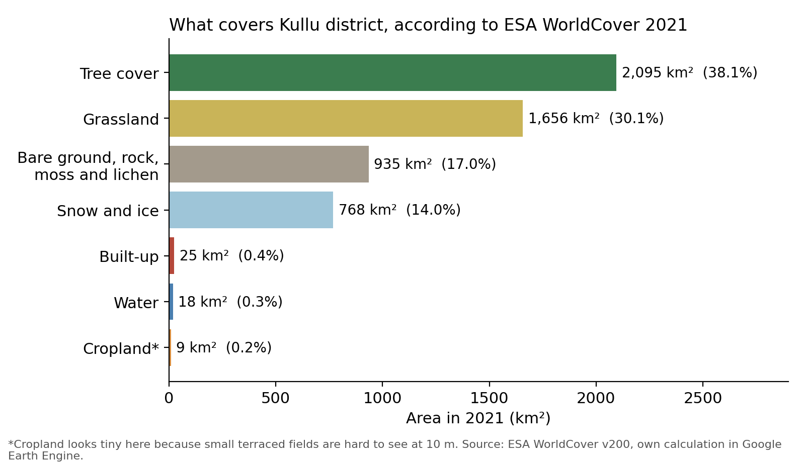
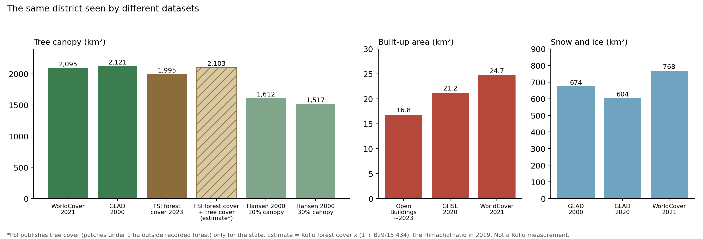
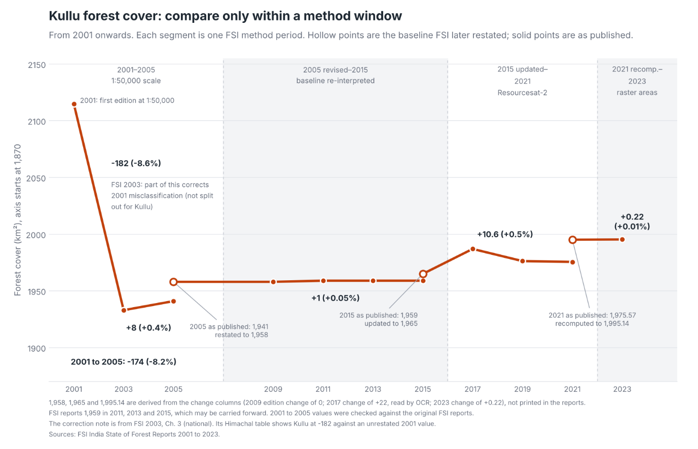
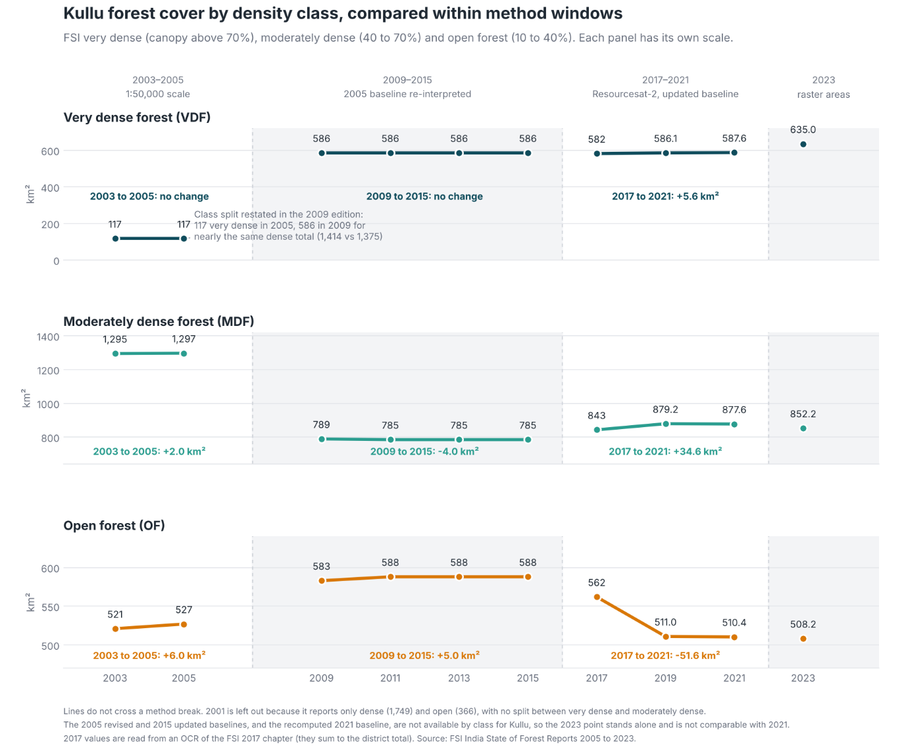
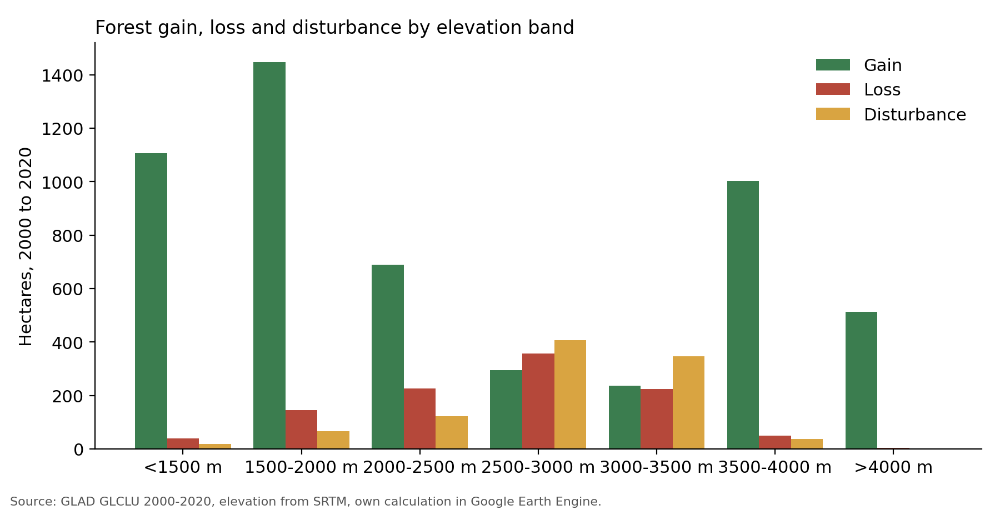

I live in the Kullu Valley, and the question I keep coming back to on my hikes is a simple one: what is all this land actually used for, and what is changing? Forests are the obvious part. Apple orchards are the next. Then there are the roads, the new buildings, the snow, and the terraced fields. I wanted numbers for all of it, in hectares, that I could check myself.

This post is the first in a series. It covers two things: what the district is made of, and what has happened to its trees. Cropland, built-up area, snow and ice, and grassland get their own posts later.

A quick note on units. A hectare (ha) is a square of 100 metres by 100 metres. A square kilometre (km²) is 100 hectares. Kullu district is a little over 5,500 km² [6], which is about 550,000 hectares.

## Where the Numbers Come From

Most of what follows comes from satellite datasets that I processed in Google Earth Engine, a free platform that lets you run calculations on satellite data without downloading it.

I also used the Forest Survey of India's (FSI) reports, which is the official count of forest in India [8].

Satellite datasets are good at showing patterns across a whole district. They are poor at telling you what is on a particular piece of ground. A pixel is a square of land, 10 or 30 metres on a side, and the satellite assigns it one label. A steep terraced field with apple trees along the edges may get labelled as trees, as grass, or as cropland, depending on the dataset. I'll come back to this several times, because it turns out to matter a lot in Kullu.

## What Covers Kullu District

Figure 1 is a plain count of land cover for 2021 using ESA WorldCover, a global map made by the European Space Agency at 10 metre resolution [1]. I chose it as the main source because its classes are simple, it's fine-grained enough for a mountain district, and its tree and built-up numbers agree with other sources (more on that in the next section).

*Figure 1. Land cover of Kullu district in 2021, from ESA WorldCover.*

Trees cover about 2,095 km², or 38% of the district [1]. Grassland comes second at about 1,656 km² (30%). Together they account for more than two thirds of Kullu. Next comes bare ground, rock, moss and lichen at 935 km² (17%), and then snow and ice at 768 km² (14%).

The third bar in Figure 1 needs explaining. WorldCover has a separate class called moss and lichen, which sounds like a forest floor but isn't. It's ground at high altitude covered by mosses and lichens with nothing taller growing on it. Together with WorldCover's "bare or sparse vegetation" class, it makes up 17% of the district. That is my reading of where it sits, and I haven't checked it on the ground.

Everything we usually think of as "human use" is tiny on this map. Built-up land is about 25 km², or 0.4% of the district. Water bodies are about 18 km². And cropland is about 9 km², or 0.2%.

That cropland number is wrong, or at least badly incomplete. I'll say why in a moment.

## Why Cropland Looks Far Smaller Than It Is

According to the Himachal Pradesh government's records, Kullu's net sown area, the land that is actually planted, is somewhere around 38,000 to 39,000 hectares [12]. The UNDP's district profile gives 39,434 ha for 2016 [10]. A district-level calculation from the 2015-16 Agriculture Census, which I pulled from an open data portal called Spatial India, gives about 7% of the district, or roughly 39,000 ha [11]. Those two agree.

WorldCover finds about 880 hectares of cropland [1]. That is a bit over 2% of what the records say.

The land has not vanished. The satellite is mislabelling it. Terraced fields in Kullu are narrow, often a few metres wide, and many have trees growing on the bunds or apple orchards on them. A 10 metre pixel can't tell a terrace from the hillside around it. And since every pixel gets exactly one label, farmland that gets missed has to be called something else. The likely candidates are tree cover and grassland. I can't prove which from the maps alone.

This matters for the rest of the post, because the tree numbers may include some orchard land. I'll deal with cropland properly in a later post, when I compare it with official sown-area and fruit-area records. For now, read the cropland bar as "much smaller than reality".

## Checking the Land Cover Figure Against Other Datasets

A single source can be wrong in ways you can't see. So for the three things I care most about, trees, buildings, and snow, I compared WorldCover with other datasets (Figure 2).

*Figure 2. Tree canopy, built-up area and snow in Kullu district as measured by different datasets. The hatched bar is a rough estimate, not a measurement.*

**Tree canopy** agrees well across the satellite sources. WorldCover (2021) gives 2,095 km² [1]. GLAD, a land cover dataset from the University of Maryland, puts forest in 2000 at about 2,121 km² [3]. The FSI's forest cover for 2023 is 1,995 km² [8], about 5 to 6% lower.

That small gap has a likely explanation. The FSI also reports what it calls tree cover: tree patches smaller than one hectare outside recorded forest, including scattered trees and small plantations. Forest cover plus tree cover is what the satellites are closest to, and in its 2023 report the FSI gives a combined "forest and tree cover" total. The catch is that it publishes tree cover only for the state, not for districts. For Himachal it was about 829 km² in 2019, on top of 15,434 km² of forest cover [8], so about 5.4% extra. If Kullu had the same ratio, forest cover plus tree cover would come to about 2,100 km², almost exactly what WorldCover and GLAD show. I've drawn that as the hatched bar in Figure 2. It's a rough scaling and not a measurement. Kullu has a lot of orchards, so its own ratio could be quite different.

Hansen's Global Forest Change dataset, from the same Maryland group [2], gives lower numbers. It asks you to pick a canopy threshold, how much of a pixel must be covered by treetops before it counts. At a 10% threshold, the district has about 1,612 km² of tree canopy in 2000. At 30% it has about 1,517 km². Raise the bar and you count less. The land hasn't changed, only the question.

Even at the same 10% cut-off the FSI uses, Hansen sits about 380 km² below the FSI's figure. I don't know why. My guess is that Hansen judges canopy pixel by pixel at 30 metres, while the FSI judges it over patches of at least a hectare, but I haven't confirmed that.

**Built-up area** agrees across the sources that count buildings. The Global Human Settlement Layer (GHSL), which maps building footprints from satellite images, gives about 21 km² for 2020 [4]. WorldCover (2021) gives 25 km² [1]. Google's Open Buildings dataset, which outlines individual buildings (about 251,000 in Kullu), adds up to 17 to 18 km² for roughly 2023 [5]. So the true figure for building footprints is somewhere around 17 to 25 km², or 0.3% to 0.45% of the district.

I also tried two other datasets that claim to map built-up land over time, Esri's 10 metre land use map and the built-up layer in GLAD. Their numbers were wildly higher, between about 90 and 290 km². When I checked GLAD's layer on the map, a point on the Beas riverbed was labelled built-up. I dropped both. When a dataset says a riverbed is a town, I can't trust it to tell me how much Kullu has grown.

One caution on the building-based numbers. They count roofs. They don't count roads, parking lots, or the cleared and levelled ground around construction sites. So 0.4% understates the land that humans have converted, even if it's close to right for buildings. Roads get their own post.

**Snow and ice** is where the datasets disagree most. GLAD puts perennial snow and ice at 674 km² in 2000 and 604 km² in 2020 [3]. WorldCover gives 768 km² for 2021 [1], about 160 km² more than GLAD's figure for 2020. Snow cover varies with the season of the image, which is why I'm not going to say anything firm about it here. That's a topic for its own post.

## Three Ways of Counting Forest

Before the tree cover numbers, a problem of vocabulary. The word "forest" means at least three different things in India's official reports, and a fourth thing in satellite datasets. If you mix them up, the numbers contradict each other.

The FSI uses three terms [8]. **Forest cover** is any piece of land larger than 1 hectare with tree canopy over more than 10% of its area, whoever owns it and whatever its legal status. This is mapped from satellite images, with a minimum mapping unit of 1 hectare. An orchard, a tea garden, or a bamboo patch counts as forest cover if it passes those thresholds. So the FSI's "forest cover" includes plantations. It is a measure of trees from above, not of natural forest.

**Recorded forest area (RFA)** is the legal definition. It is land that the government has notified as forest, or recorded as forest in its records, which is divided into Reserved Forests, Protected Forests and Unclassed Forests. Land can be recorded forest area and have no trees at all, and the reverse is also true.

**Tree cover**, in the FSI's terms, is the third category: trees outside the recorded forest area, in patches smaller than 1 hectare, along roads or fields, and in towns.

The gap between the first two is large in Himachal. Only about 28% of the state has forest cover, but around 68% is recorded forest area [12]. For Kullu, the numbers are about 36% and 83% [8]. That means forest laws apply to over four fifths of the district, though most of the recorded forest above the treeline is rock, snow, or alpine pasture.

The FSI also maps from satellites, and it uses the words "tree cover" for something else, so I'm going to call what the global datasets measure **tree canopy**. This means trees taller than about 5 metres, seen from above, including orchards and plantations. It's closest to the FSI's forest cover plus tree cover, but the cut-offs differ, so the numbers won't match exactly.

## What the Forest Survey of India Says

The FSI publishes a report every two years, the India State of Forest Report [8]. The first edition that maps forest cover digitally at a useful scale is 2001, so that's where I start the series for Kullu.

*Figure 3. Kullu's forest cover in the FSI reports, 2001 to 2023. Compare only points within the same method window. Hollow points are baselines that the FSI later restated.*

At first look (Figure 3), forest cover fell sharply between the 2001 and 2003 editions and has barely moved since. But the 2001 edition can't be compared with what came after it. The FSI's 2003 report says part of that drop corrects misclassification in the 2001 edition, but it doesn't say how much of it applies to Kullu. I leave 2001 out of everything that follows.

The second problem is that the FSI changed its method in 2001, 2009, 2017 and 2023, and each change came with a revision of the year before. Almost every revision went upwards. The 2005, 2015 and 2021 figures were all restated this way in later editions.

From 2003 to 2023 the reported cover rose, but roughly two thirds of that increase comes from the restatements. The rest is change the FSI measured between editions that used the same method.

So if I compare only editions within the same method window, there has been a slight gain, about 1% of the area in total. Inside the 2015 to 2021 window most of it came in the 2017 edition, and the figure partly fell back in 2019 and 2021. I wouldn't read more into it than "no sign of decline".

Where does the gain come from? The FSI doesn't say, but it counts orchards. Its forest cover includes any orchard larger than 1 hectare with more than 10% canopy [8], and orchards in Kullu have grown a lot. According to the Horticulture Department, the area under fruit rose from about 19,400 ha in 1990-91 to about 31,300 ha in 2022-23, and apple drives that increase, from about 14,300 ha to about 27,400 ha [9]. It looks to me as though much of the FSI's gain may come from orchards. I can't confirm that, because the FSI doesn't separate orchards from forest, and many young orchards will be too small or too thin in canopy to count.

The FSI also grades its forest cover by canopy density. In the 2023 report [8] (Figure 4), Kullu has about 635 km² of very dense forest (canopy above 70%), 852 km² of moderately dense forest (40 to 70%), and 508 km² of open forest (10 to 40%). Together that's the 1,995 km².

*Figure 4. Kullu's forest cover by canopy density class in the FSI reports. Compare only within a method window.*

Between 2005 and 2009, the dense forest area barely moved, but a lot of what had been classified as moderately dense got reclassified into very dense or open. That wasn't the forest changing. The FSI changed its satellite sensor and its classification algorithm in 2009. Between 2017 and 2021, moderately dense forest increased slightly and open forest dropped noticeably.

The limit of this kind of data is that it measures the treetops from above. A forest that has been lopped for fodder and grazed hard can look identical from a satellite to a healthy one, as long as the canopy stays closed. So the FSI can tell us whether there are trees. It can't tell us much about the state of the forest underneath.

## What Published Studies Say About Kullu's Forests

I looked for published studies of forest change in Kullu to set against these numbers. Most of them cover a single valley or watershed, and very few cover the whole district. They also use different years, maps and methods, so putting their numbers next to a district total wouldn't be a fair comparison. District totals can hide local change too. A small net loss for the district is compatible with a large loss in one valley.

A later post will start comparing my numbers with the existing literature. For that I'll run Hansen and GLAD over the same valleys the studies cover, so the comparison is like for like.

## Tree Canopy Loss: What Hansen Shows

For something more detailed than a district total, I turned to satellite data that is gridded, so you can see where change happened and not just how much.

Hansen's Global Forest Change dataset [2] is the best known. It uses Landsat satellite images at 30 metre resolution and covers 2001 to 2024. For each pixel it records canopy cover in 2000, and the year (if any) when the canopy was lost.

At a 30% canopy threshold, Kullu had about 151,600 hectares of tree cover in the year 2000. By 2024, about 1,175 hectares of it had been lost. That's 0.78% over 24 years. At a 10% threshold the numbers are similar: about 161,200 ha at the start and 1,207 ha lost, 0.75%. Raising the threshold to 50% gives 0.83%. So the rate of loss barely depends on how you set the threshold, which is reassuring.

About 80% of that loss happened in the first twelve years. From 2001 to 2012, the dataset records about 940 ha of loss, with peaks in 2001 (163 ha), 2004 (179 ha) and 2012 (182 ha). From 2013 to 2024, the total is about 240 ha, which works out to about 20 hectares a year. Hansen's loss in 2015 is essentially zero.

I'm cautious about reading this as "loss slowed down". As far as I know, the dataset was built from different satellite imagery and processing in later years, so a drop in loss after about 2012 could come partly from the method and not only from the ground. That's worth verifying before anyone leans on it. I don't know how much of the pattern is real.

What is the loss made of? "Loss" in this dataset means the canopy was removed or killed, whatever the cause. It doesn't mean deforestation. I opened the Hansen loss map next to the satellite basemap in Earth Engine and looked at the loss pixels one by one. There weren't many large clusters. They were a mix. Some were landslide scars. Some were new road cuttings. Some looked like orchards, and some had already regrown. It's a mix, and I can't split it with this data.

## Tree Canopy Gain and Loss: What GLAD Shows

GLAD's land cover and land use dataset from the University of Maryland compares 2000 with 2020 at 30 metre resolution [3]. It defines forest as trees taller than 5 metres, with no canopy threshold, and it counts planted trees, agroforestry and orchards. For each pixel it gives a class: stable forest, forest loss, forest gain, or stand-replacement disturbance.

For Kullu, the numbers are:

- Forest in 2000: about 212,100 ha (2,121 km²)
- Forest loss, 2001 to 2020: about 1,040 ha
- Forest gain, 2001 to 2020: about 5,305 ha
- Disturbance or degradation: about 1,003 ha

The net result is a gain of about 4,265 hectares, or about 2% of the forest that was there in 2000. So by this dataset, Kullu's tree canopy has grown, not shrunk. The loss number, about 1,040 ha, is close to Hansen's, about 1,175 ha at 30% canopy for a slightly longer period. Hansen's gain layer stops at 2012, so there's nothing to compare the gain with, and I wanted to know where it was happening.

I split the district into seven elevation bands using SRTM, a radar elevation model [7]. Figure 5 and the table below show the result. Kullu goes from about 740 metres at the lowest point to about 6,396 metres on the highest peaks.

*Figure 5. Forest gain, loss and disturbance in Kullu by elevation band, 2000 to 2020, from GLAD.*

<table style="width:100%;border-collapse:collapse;"><tbody>
<tr><th style="border-bottom:2px solid #d4cabb;padding:8px 10px;text-align:left;font-size:0.8rem;color:#6b5e4e;vertical-align:bottom;">Elevation</th><th style="border-bottom:2px solid #d4cabb;padding:8px 10px;text-align:left;font-size:0.8rem;color:#6b5e4e;vertical-align:bottom;">Forest in 2000 (ha)</th><th style="border-bottom:2px solid #d4cabb;padding:8px 10px;text-align:left;font-size:0.8rem;color:#6b5e4e;vertical-align:bottom;">Gain (ha)</th><th style="border-bottom:2px solid #d4cabb;padding:8px 10px;text-align:left;font-size:0.8rem;color:#6b5e4e;vertical-align:bottom;">Loss (ha)</th><th style="border-bottom:2px solid #d4cabb;padding:8px 10px;text-align:left;font-size:0.8rem;color:#6b5e4e;vertical-align:bottom;">Net change as % of 2000 forest</th><th style="border-bottom:2px solid #d4cabb;padding:8px 10px;text-align:left;font-size:0.8rem;color:#6b5e4e;vertical-align:bottom;">Disturbance (ha)</th></tr>
<tr><td style="padding:8px 10px;border-bottom:1px solid #e2dbd0;font-size:0.9rem;width:auto;font-weight:400;color:#1a1612;">Below 1,500 m</td><td style="padding:8px 10px;border-bottom:1px solid #e2dbd0;font-size:0.9rem;width:auto;font-weight:400;color:#1a1612;">12,545</td><td style="padding:8px 10px;border-bottom:1px solid #e2dbd0;font-size:0.9rem;width:auto;font-weight:400;color:#1a1612;">1,106</td><td style="padding:8px 10px;border-bottom:1px solid #e2dbd0;font-size:0.9rem;width:auto;font-weight:400;color:#1a1612;">39</td><td style="padding:8px 10px;border-bottom:1px solid #e2dbd0;font-size:0.9rem;width:auto;font-weight:400;color:#1a1612;">+8.5%</td><td style="padding:8px 10px;border-bottom:1px solid #e2dbd0;font-size:0.9rem;width:auto;font-weight:400;color:#1a1612;">18</td></tr>
<tr><td style="padding:8px 10px;border-bottom:1px solid #e2dbd0;font-size:0.9rem;width:auto;font-weight:400;color:#1a1612;">1,500 to 2,000 m</td><td style="padding:8px 10px;border-bottom:1px solid #e2dbd0;font-size:0.9rem;width:auto;font-weight:400;color:#1a1612;">28,074</td><td style="padding:8px 10px;border-bottom:1px solid #e2dbd0;font-size:0.9rem;width:auto;font-weight:400;color:#1a1612;">1,448</td><td style="padding:8px 10px;border-bottom:1px solid #e2dbd0;font-size:0.9rem;width:auto;font-weight:400;color:#1a1612;">144</td><td style="padding:8px 10px;border-bottom:1px solid #e2dbd0;font-size:0.9rem;width:auto;font-weight:400;color:#1a1612;">+4.6%</td><td style="padding:8px 10px;border-bottom:1px solid #e2dbd0;font-size:0.9rem;width:auto;font-weight:400;color:#1a1612;">67</td></tr>
<tr><td style="padding:8px 10px;border-bottom:1px solid #e2dbd0;font-size:0.9rem;width:auto;font-weight:400;color:#1a1612;">2,000 to 2,500 m</td><td style="padding:8px 10px;border-bottom:1px solid #e2dbd0;font-size:0.9rem;width:auto;font-weight:400;color:#1a1612;">48,274</td><td style="padding:8px 10px;border-bottom:1px solid #e2dbd0;font-size:0.9rem;width:auto;font-weight:400;color:#1a1612;">688</td><td style="padding:8px 10px;border-bottom:1px solid #e2dbd0;font-size:0.9rem;width:auto;font-weight:400;color:#1a1612;">226</td><td style="padding:8px 10px;border-bottom:1px solid #e2dbd0;font-size:0.9rem;width:auto;font-weight:400;color:#1a1612;">+1.0%</td><td style="padding:8px 10px;border-bottom:1px solid #e2dbd0;font-size:0.9rem;width:auto;font-weight:400;color:#1a1612;">122</td></tr>
<tr><td style="padding:8px 10px;border-bottom:1px solid #e2dbd0;font-size:0.9rem;width:auto;font-weight:400;color:#1a1612;">2,500 to 3,000 m</td><td style="padding:8px 10px;border-bottom:1px solid #e2dbd0;font-size:0.9rem;width:auto;font-weight:400;color:#1a1612;">61,216</td><td style="padding:8px 10px;border-bottom:1px solid #e2dbd0;font-size:0.9rem;width:auto;font-weight:400;color:#1a1612;">294</td><td style="padding:8px 10px;border-bottom:1px solid #e2dbd0;font-size:0.9rem;width:auto;font-weight:400;color:#1a1612;">356</td><td style="padding:8px 10px;border-bottom:1px solid #e2dbd0;font-size:0.9rem;width:auto;font-weight:400;color:#1a1612;">-0.1%</td><td style="padding:8px 10px;border-bottom:1px solid #e2dbd0;font-size:0.9rem;width:auto;font-weight:400;color:#1a1612;">407</td></tr>
<tr><td style="padding:8px 10px;border-bottom:1px solid #e2dbd0;font-size:0.9rem;width:auto;font-weight:400;color:#1a1612;">3,000 to 3,500 m</td><td style="padding:8px 10px;border-bottom:1px solid #e2dbd0;font-size:0.9rem;width:auto;font-weight:400;color:#1a1612;">50,343</td><td style="padding:8px 10px;border-bottom:1px solid #e2dbd0;font-size:0.9rem;width:auto;font-weight:400;color:#1a1612;">237</td><td style="padding:8px 10px;border-bottom:1px solid #e2dbd0;font-size:0.9rem;width:auto;font-weight:400;color:#1a1612;">225</td><td style="padding:8px 10px;border-bottom:1px solid #e2dbd0;font-size:0.9rem;width:auto;font-weight:400;color:#1a1612;">about 0%</td><td style="padding:8px 10px;border-bottom:1px solid #e2dbd0;font-size:0.9rem;width:auto;font-weight:400;color:#1a1612;">346</td></tr>
<tr><td style="padding:8px 10px;border-bottom:1px solid #e2dbd0;font-size:0.9rem;width:auto;font-weight:400;color:#1a1612;">3,500 to 4,000 m</td><td style="padding:8px 10px;border-bottom:1px solid #e2dbd0;font-size:0.9rem;width:auto;font-weight:400;color:#1a1612;">11,192</td><td style="padding:8px 10px;border-bottom:1px solid #e2dbd0;font-size:0.9rem;width:auto;font-weight:400;color:#1a1612;">1,003</td><td style="padding:8px 10px;border-bottom:1px solid #e2dbd0;font-size:0.9rem;width:auto;font-weight:400;color:#1a1612;">50</td><td style="padding:8px 10px;border-bottom:1px solid #e2dbd0;font-size:0.9rem;width:auto;font-weight:400;color:#1a1612;">+8.5%</td><td style="padding:8px 10px;border-bottom:1px solid #e2dbd0;font-size:0.9rem;width:auto;font-weight:400;color:#1a1612;">37</td></tr>
<tr><td style="padding:8px 10px;border-bottom:1px solid #e2dbd0;font-size:0.9rem;width:auto;font-weight:400;color:#1a1612;">Above 4,000 m</td><td style="padding:8px 10px;border-bottom:1px solid #e2dbd0;font-size:0.9rem;width:auto;font-weight:400;color:#1a1612;">456</td><td style="padding:8px 10px;border-bottom:1px solid #e2dbd0;font-size:0.9rem;width:auto;font-weight:400;color:#1a1612;">513</td><td style="padding:8px 10px;border-bottom:1px solid #e2dbd0;font-size:0.9rem;width:auto;font-weight:400;color:#1a1612;">4</td><td style="padding:8px 10px;border-bottom:1px solid #e2dbd0;font-size:0.9rem;width:auto;font-weight:400;color:#1a1612;">+112%</td><td style="padding:8px 10px;border-bottom:1px solid #e2dbd0;font-size:0.9rem;width:auto;font-weight:400;color:#1a1612;">2</td></tr>
</tbody></table>

Three things stand out.

The loss rate is nearly flat across elevations, between 0.3% and 0.6% of the forest in each band. There's no sign in this dataset that loss was concentrated at any particular elevation.

Disturbance, which is the dataset's word for a stand being wiped out or badly damaged, is highest between 2,500 and 3,500 metres, at about 407 ha and 346 ha. That's the middle of the forest zone, where I'd expect the fir and spruce stands. I don't know the cause. It could be fire, grazing, landslides, or harvest. The data doesn't say.

And the gain is lopsided. Over half of it, about 2,550 ha, is below 2,000 metres. A second large block, about 1,500 ha, is above 3,500 metres. The middle bands have little gain. These two zones need separate explanations.

## Tree Gain Below 2,000 Metres: Is It Orchards?

The lower valley is where most people live and farm, and where the gain is largest in relative terms: 8.5% below 1,500 metres and 4.6% between 1,500 and 2,000. New trees there are unlikely to be wilderness. So I looked at what the gain pixels used to be, how tall the trees are, and how steep the ground is.

<table style="width:100%;border-collapse:collapse;"><tbody>
<tr><th style="border-bottom:2px solid #d4cabb;padding:8px 10px;text-align:left;font-size:0.8rem;color:#6b5e4e;vertical-align:bottom;"></th><th style="border-bottom:2px solid #d4cabb;padding:8px 10px;text-align:left;font-size:0.8rem;color:#6b5e4e;vertical-align:bottom;">Below 1,500 m</th><th style="border-bottom:2px solid #d4cabb;padding:8px 10px;text-align:left;font-size:0.8rem;color:#6b5e4e;vertical-align:bottom;">1,500 to 2,000 m</th></tr>
<tr><td style="padding:8px 10px;border-bottom:1px solid #e2dbd0;font-size:0.9rem;width:auto;font-weight:400;color:#1a1612;">Gain (ha)</td><td style="padding:8px 10px;border-bottom:1px solid #e2dbd0;font-size:0.9rem;width:auto;font-weight:400;color:#1a1612;">1,106</td><td style="padding:8px 10px;border-bottom:1px solid #e2dbd0;font-size:0.9rem;width:auto;font-weight:400;color:#1a1612;">1,448</td></tr>
<tr><td style="padding:8px 10px;border-bottom:1px solid #e2dbd0;font-size:0.9rem;width:auto;font-weight:400;color:#1a1612;">Share that was cropland in 2000-03</td><td style="padding:8px 10px;border-bottom:1px solid #e2dbd0;font-size:0.9rem;width:auto;font-weight:400;color:#1a1612;">24%</td><td style="padding:8px 10px;border-bottom:1px solid #e2dbd0;font-size:0.9rem;width:auto;font-weight:400;color:#1a1612;">6%</td></tr>
<tr><td style="padding:8px 10px;border-bottom:1px solid #e2dbd0;font-size:0.9rem;width:auto;font-weight:400;color:#1a1612;">Share with trees under 10 m tall</td><td style="padding:8px 10px;border-bottom:1px solid #e2dbd0;font-size:0.9rem;width:auto;font-weight:400;color:#1a1612;">67%</td><td style="padding:8px 10px;border-bottom:1px solid #e2dbd0;font-size:0.9rem;width:auto;font-weight:400;color:#1a1612;">43%</td></tr>
<tr><td style="padding:8px 10px;border-bottom:1px solid #e2dbd0;font-size:0.9rem;width:auto;font-weight:400;color:#1a1612;">Share on slopes under 15 degrees</td><td style="padding:8px 10px;border-bottom:1px solid #e2dbd0;font-size:0.9rem;width:auto;font-weight:400;color:#1a1612;">52%</td><td style="padding:8px 10px;border-bottom:1px solid #e2dbd0;font-size:0.9rem;width:auto;font-weight:400;color:#1a1612;">35%</td></tr>
<tr><td style="padding:8px 10px;border-bottom:1px solid #e2dbd0;font-size:0.9rem;width:auto;font-weight:400;color:#1a1612;">Same slope share for existing forest</td><td style="padding:8px 10px;border-bottom:1px solid #e2dbd0;font-size:0.9rem;width:auto;font-weight:400;color:#1a1612;">19%</td><td style="padding:8px 10px;border-bottom:1px solid #e2dbd0;font-size:0.9rem;width:auto;font-weight:400;color:#1a1612;">8%</td></tr>
</tbody></table>

(The cropland comparison uses the University of Maryland's global cropland maps, which cover herbaceous crops like wheat, maize and vegetables, in four-year windows [14].)

The new tree cover is lower and flatter than the existing forest. Above half of the gain below 1,500 metres is on gentle slopes, where only a fifth of the old forest stands. Two thirds of it is less than 10 metres tall. A quarter of it was cropland in the early 2000s. Those are the fingerprints of trees planted on or beside farmland.

The same cropland maps show something else. Cropland as the maps record it fell by about 30% below 1,500 metres, from about 2,208 ha in the early 2000s to 1,544 ha in 2016 to 2019. Between 1,500 and 2,000 metres it fell by about 26%, from 1,743 ha to 1,291 ha. Of the cropland that disappeared, about 22% below 1,500 m and 11% between 1,500 and 2,000 m now shows up as tree gain. So some farmland has been replaced by trees. Which trees, the data can't say.

The Himachal Pradesh Horticulture Department publishes fruit area by district. For Kullu, the total area under fruit rose from about 19,400 ha in 1990-91 to about 31,300 ha in 2022-23, and most of that increase was apple, which went from about 14,300 ha to about 27,400 ha [9]. The Kullu Forest Division's 2013 working plan says the same thing in words: apple orchards have spread into mixed agricultural land and up the mountain slopes [13].

There's a catch. GLAD's "forest" needs trees taller than 5 metres. Modern high-density apple orchards use dwarf rootstocks that stay shorter than that. If so, those orchards would be invisible to the forest class, and the gain I'm seeing would be older, taller plantings or trees on field edges. I haven't tested this, and I don't know how much of the gain is which.

So my reading is: the low-elevation gain fits trees planted on or beside farmland, and orchards are a likely part of it, but orchards can't be separated from natural regrowth on abandoned fields with this data.

## Tree Gain Above 3,500 Metres: Probably Not Forest

The other block of gain is above 3,500 metres, about 1,516 hectares, in a zone that had just 11,648 ha of forest in 2000. Above 4,000 metres, the gain (513 ha) is larger than the whole band's forest in 2000 (456 ha). A band can't gain more forest than it had unless something other than forest is being counted.

I don't think this is real forest. At those heights, near and above the natural treeline, the likeliest explanation is that something else is being labelled as tall trees.

## What I Take From This

1. Kullu has a lot of trees: about 38% of the district, depending on how you count. That holds up across WorldCover, GLAD and the FSI, and a rough 2,000 km² is a safe number for tree canopy.
2. Loss is small. Hansen finds about 1,175 ha lost since 2000, less than 0.8% of the tree cover, and GLAD finds a similar figure.
3. The FSI series can't be compared across its method changes. Most of the increase in reported forest cover since 2003 comes from the FSI restating earlier years. Within a single method window the change is slight.
4. The main uncertainty is about gain. GLAD finds thousands of hectares of new tree cover, mostly in the lower valley, which fits orchards and farm-edge planting. Some is in the high mountains, where it probably doesn't fit anything real. Orchards may also explain part of the FSI's gain, but none of these datasets can separate orchards from forest.
5. None of these datasets tells me about forest quality. They see canopy. They can't see lopped branches, an overgrazed understorey, or a spruce stand replaced by a young plantation. For that I need field work, and the FSI's own sample plots, which I haven't looked at.
6. Treat satellite figures as good to a few percent for the district, not to the hectare. Where I've given a precise figure, such as 1,175 ha, it's what the calculation returned, not a claim about accuracy on the ground.

## What's Next

The next post is about cropland. The satellite maps find fewer than 900 hectares, the government records find about 39,000, and the area under fruit has grown by about 12,000 hectares since 1990. I want to see whether the land that is missing from the satellite's cropland is the same land that shows up as tree gain. After that comes built-up area, where the building data goes back to 1975 and shows the footprint growing by about 2.3 times since 2000, followed by snow, ice, and grassland.

## Sources

1. ESA WorldCover 10 m land cover, version 200 (2021): https://esa-worldcover.org
2. Hansen, Potapov and others, Global Forest Change 2000-2024 (version 1.12): https://glad.earthengine.app/view/global-forest-change
3. GLAD Global Land Cover and Land Use Change 2000-2020 (Potapov and others): https://glad.umd.edu/dataset/GLCLU2020
4. Global Human Settlement Layer, GHS-BUILT-S (JRC): https://ghsl.jrc.ec.europa.eu
5. Google Open Buildings, version 3: https://sites.research.google/open-buildings/
6. FAO GAUL 2015 administrative boundaries, via Google Earth Engine
7. SRTM elevation (USGS), via Google Earth Engine
8. Forest Survey of India, India State of Forest Report, 2001 to 2023 editions: https://fsi.nic.in
9. Himachal Pradesh Horticulture Department, district-wise area under different fruits, 1990-91 to 2024-25
10. UNDP, Kullu District Profile (2018)
11. Agriculture Census 2015-16, via Spatial India: https://spatialindia.com
12. Government of Himachal Pradesh, Economic Survey 2025-26
13. Himachal Pradesh Forest Department, Kullu Forest Division Working Plan (2013)
14. University of Maryland (GLAD), global cropland extent maps, four-year windows from 2000-03 to 2016-19
